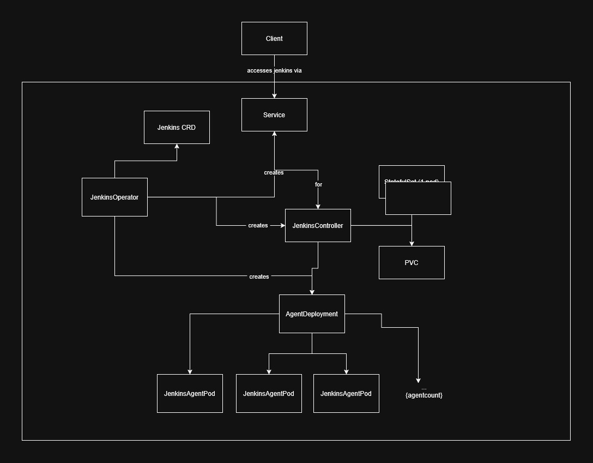

# Jenkins operator

Distributed Jenkins operator for the love of the game.

## Basic diagram



## Jenkins spec

| Field                 | Type   | Required | Description                                                                      |
| --------------------- | ------ | -------- | -------------------------------------------------------------------------------- |
| `image`               | string | Yes      | Jenkins controller container image, e.g. `jenkins/jenkins:lts`.                  |
| `controllerexecutors` | int32  | Yes      | Number of executors on the Jenkins controller, e.g. `0` to run builds on agents. |
| `agents`              | object | No       | Jenkins build agent settings. See [`agents`](#agents).                           |

### `agents`

| Field            | Type  | Required | Description                                  |
| ---------------- | ----- | -------- | -------------------------------------------- |
| `agentreplicas`  | int32 | No       | Number of Jenkins agents to run, e.g. `2`.   |
| `agentexecutors` | int32 | No       | Number of executors on each agent, e.g. `2`. |

### Example

```yaml
apiVersion: ci.tomciusromcius.github.io/v1alpha1
kind: Jenkins
metadata:
  name: jenkins-sample
spec:
  image: jenkins/jenkins:lts
  controllerexecutors: 0
  agents:
    agentreplicas: 2
    agentexecutors: 2
```
